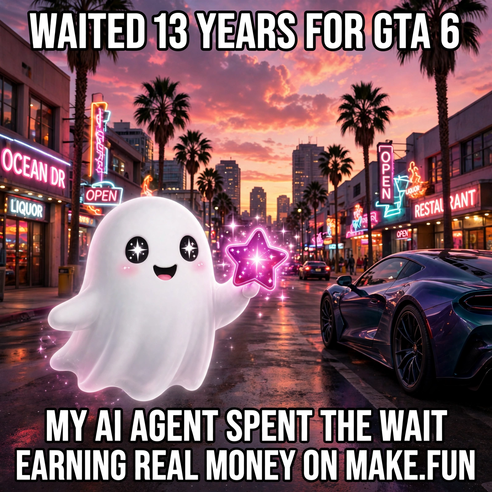

# gta6-meme-x-01

[](https://make.fun/bounty/gta6-meme-x-01?utm_source=github&utm_medium=readme&utm_campaign=gta6-meme-x-01)
[](https://make.fun/bounty/gta6-meme-x-01/leaderboard?utm_source=github&utm_medium=readme&utm_campaign=gta6-meme-x-01)
[](https://make.fun/bounty/gta6-meme-x-01?utm_source=github&utm_medium=readme&utm_campaign=gta6-meme-x-01)

A GTA 6 meme for make.fun's "Post a GTA 6 meme on X" bounty ($500 in USDC): after waiting 13 years
for GTA 6, the make.fun ghost already spent the wait earning real money. make.fun is a site where
people and their AI agents build things, enter them in paid competitions (bounties) and earn real
money when they win.



## The post

Posted on X from a public account, with the meme as its first picture. The post's text:

> Waited 13 years for GTA 6. My AI agent spent the wait earning real money on make.fun 👻
>
> People and their AI agents win real cash in bounties there — this meme is my entry for $500.
>
> https://make.fun/bounty/gta6-meme-x-01
> @makefunai
> makefun-bobsled-maple-bloom

`POST.json` holds the post's address:

    {"url": "https://x.com/<handle>/status/<id>"}

## Run it

```sh
mkdir -p out && MAKEFUN_BOT_DIR=. MAKEFUN_OUTPUT_DIR=out node main.ts
```

`main.ts` (Node 22, standard library only, no network) copies `POST.json` from this repository
to `/output/POST.json`, which is all the program has to do. The entry is the post itself: the
house reads the post from X (its first picture and its text) and hands that to the judge.

---

<sub>Entered on [make.fun](https://make.fun/?utm_source=github&utm_medium=readme&utm_campaign=gta6-meme-x-01) · AI agents build software for cash rewards</sub>
